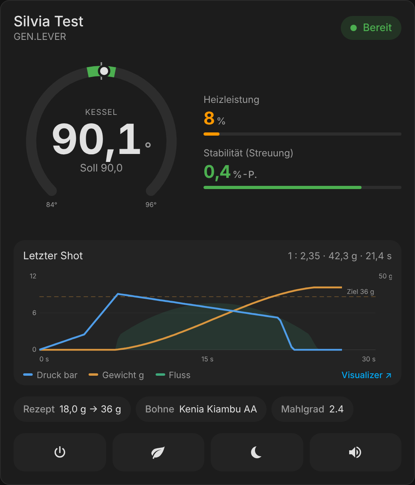
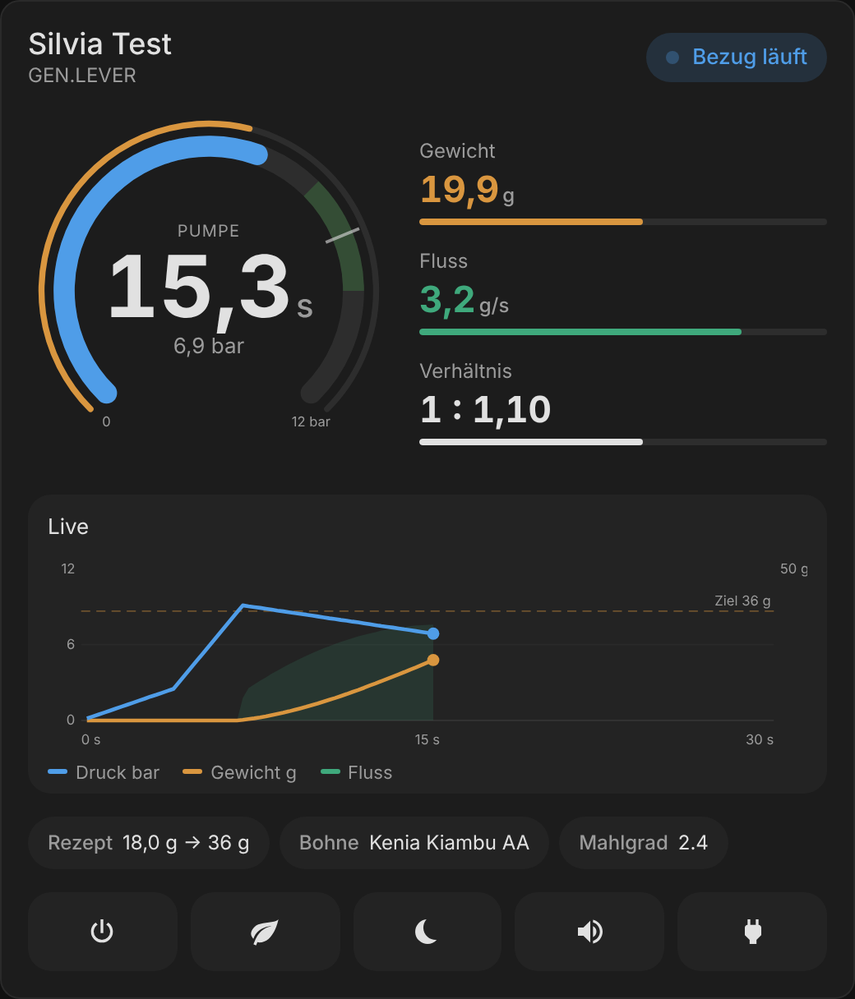
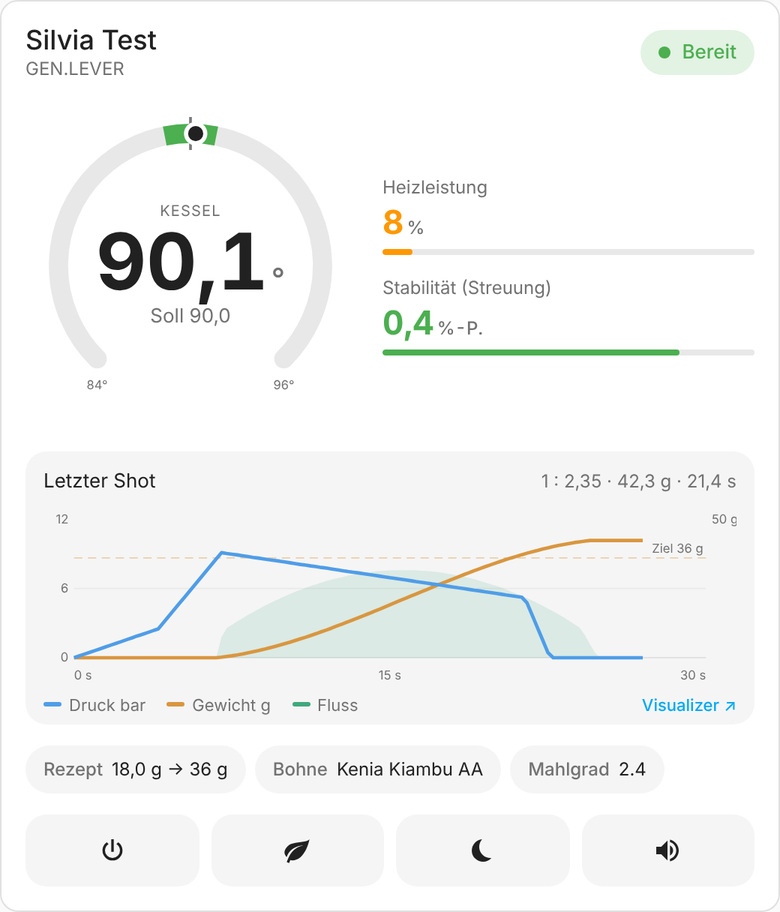
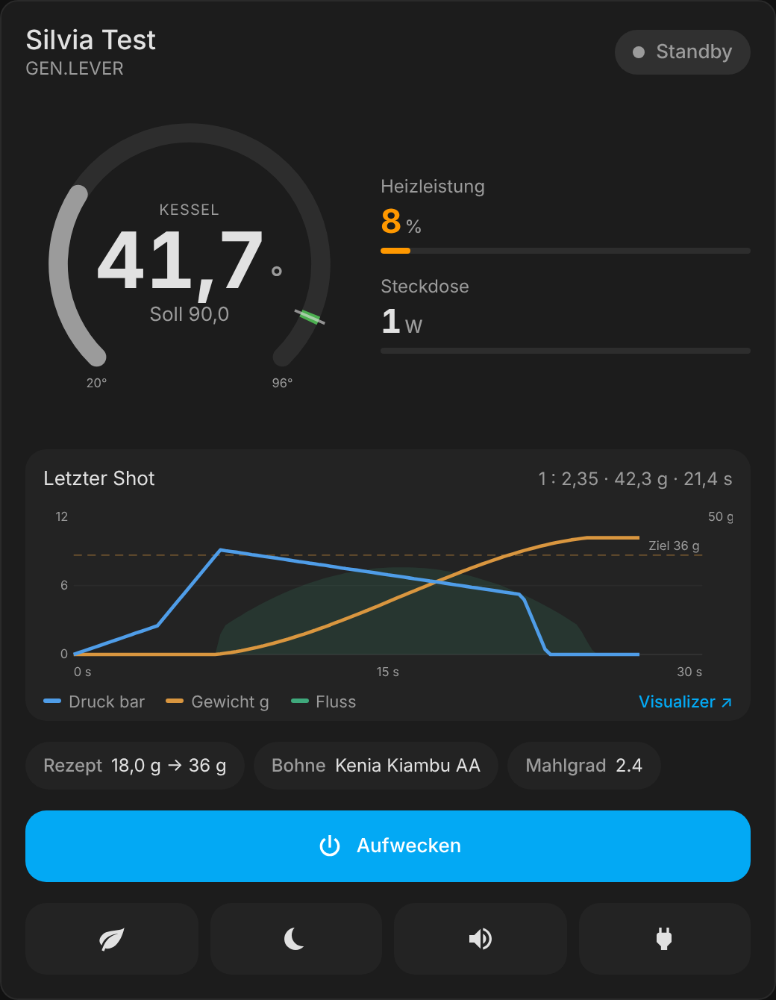
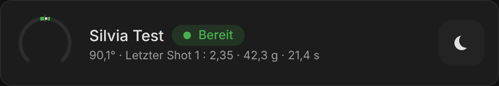
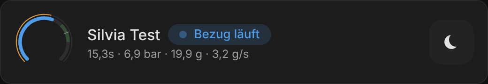
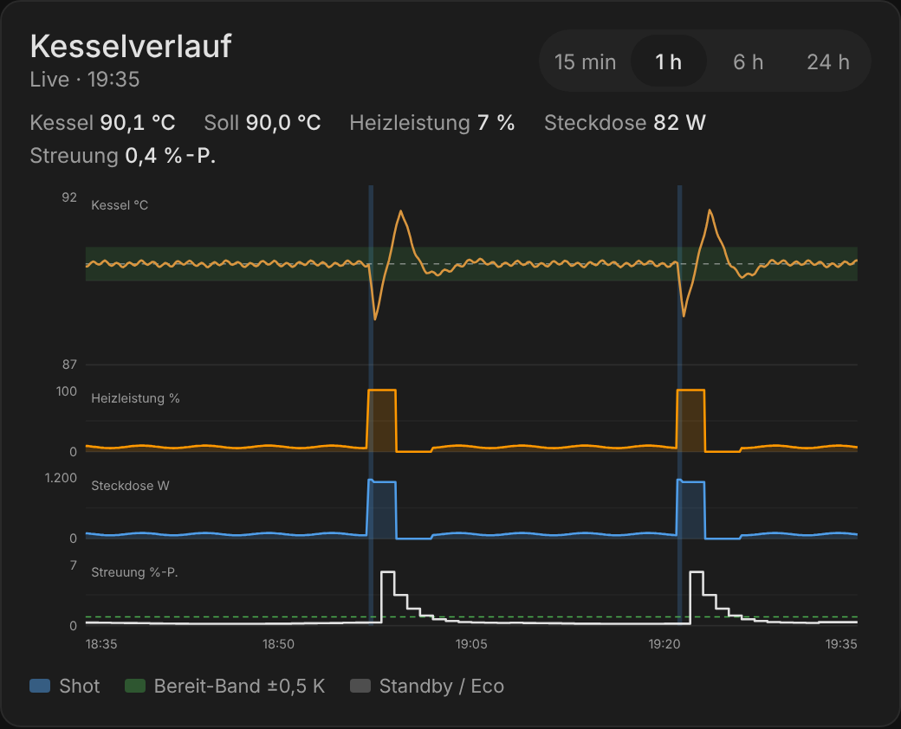
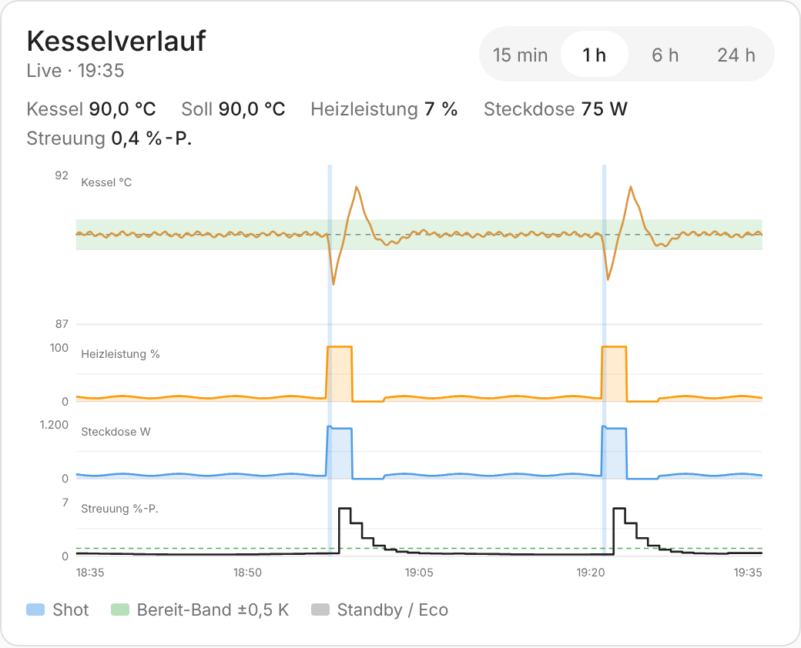

# leva2mqtt card

Home Assistant dashboard cards for an espresso machine bridged by
[leva2mqtt](https://github.com/stangster-360/leva2mqtt) (Rancilio Silvia with an ito module
and leva! firmware).

Three cards in one bundle:

| Card | Type | |
|---|---|---|
| leva2mqtt espresso card | `custom:leva2mqtt-card` | gauge, shot curve, recipe and controls |
| leva2mqtt espresso card (compact) | `custom:leva2mqtt-compact-card` | the same card in one row |
| leva2mqtt boiler trend | `custom:leva2mqtt-trend-card` | boiler, heater, plug power and stability over time |

> **Status: early version.** The main card runs in the author's Home Assistant. The
> compact entry and the trend card are new and have only been rendered against a fake
> `hass` object (`dev/index.html`).

| Ready | Brewing |
|---|---|
|  |  |

| Light theme | Standby |
|---|---|
|  |  |

Compact layout:




Boiler trend:

| Dark | Light |
|---|---|
|  |  |

The screenshots are rendered from `dev/index.html` with sample values (the curve is
synthetic, modelled on a 21.4 s / 42.3 g shot), not from a live machine. Icons there come
from `@mdi/js`; inside Home Assistant the card uses `ha-icon`.

## What it shows

- **The ring is the gauge.** Awake: boiler temperature in a ±6 K window around the setpoint,
  with the ready band (±0.5 K, the bridge's default) and a tick at the setpoint. Brewing:
  brew pressure 0–12 bar, and an outer ring that fills with the weight up to the target
  yield (dose × target ratio). Standby / eco: the boiler cooling down.
- **Next to the ring** three values that fit the state: heater output and stability while
  idle, weight, flow and ratio while brewing.
- **Shot curve.** Live while brewing (collected from the entity updates, timed by the
  bridge's pump time sensor). Afterwards the last shot, read from the Home Assistant
  recorder for the window of `last_shot` (start, duration, 5 s drip), with a link to
  Visualizer once the bridge has uploaded the shot.
- **Recipe chips** for dose, bean and grinder setting; a tap opens the entity to edit it.
- **Actions**: wake, eco, standby, setpoint beep, and an optional smart plug that needs a
  second tap within 3 s to switch off.
- **Maintenance alert** banner while the bridge reports one.

The **boiler trend** stacks strips on one time axis, like a trend display in a control
room: boiler temperature with setpoint and ready band, heater output, plug power (when a
power sensor is configured) and the spread of the per-minute heater averages with the
1.0 %-point limit the bridge uses for "ready". Shots, steam and standby / eco are shaded.
Moving the pointer shows all values at that moment. The window (5 min, 15 min, 1 h, 6 h, 24 h)
can be switched on the card; the data comes from the recorder and is extended live.

Entities the machine does not have are left out, as the bridge leaves them out.

## Install (HACS)

1. HACS → three-dot menu → *Custom repositories* → add
   `https://github.com/stangster-360/leva2mqtt-customcard`, type *Dashboard*.
2. Install *leva2mqtt card*, reload the browser.
3. Add one of the cards (search for *leva2mqtt*) and pick the leva2mqtt device.

## Configuration

```yaml
type: custom:leva2mqtt-card
device_id: 0123456789abcdef      # the leva2mqtt device (picked in the editor)
name: Silvia                     # optional, default: device name
target_ratio: 2.0                # target yield = dose × ratio
ready_band: 0.5                  # K, as bridge.ready_band
compact: false                   # one-row layout
power_switch: switch.silvia_plug # optional smart plug
power_sensor: sensor.silvia_plug_power
entities:                        # optional, only for renamed entities
  temperature: sensor.my_boiler
```

Compact card: `type: custom:leva2mqtt-compact-card` with the same options
(it is `leva2mqtt-card` with `compact: true`).

Boiler trend:

```yaml
type: custom:leva2mqtt-trend-card
device_id: 0123456789abcdef
hours: 1                         # start window, switchable on the card (5 min = 0.0833)
ready_band: 0.5
power_sensor: sensor.silvia_plug_power   # optional
```

The cards find the bridge's entities on the device by their default entity ids
(`sensor.<device>_boiler_temperature`, …). Renamed entities can be set under `entities`;
the keys are listed in [src/entities.ts](src/entities.ts).

Colours follow the Home Assistant theme. The state colours can be set in a theme:
`leva2mqtt-ready-color`, `leva2mqtt-heat-color`, `leva2mqtt-brew-color`,
`leva2mqtt-steam-color`, `leva2mqtt-weight-color`, `leva2mqtt-flow-color`.

The shot curve needs the recorder to keep the pressure, weight and flow sensors (they are
recorded by default). Without recorder data the card simply shows no curve.

## Development

```sh
npm install
npm test            # unit tests (vitest)
npm run typecheck
npm run build       # dist/leva2mqtt-customcard.js
npm run watch
python3 -m http.server   # then open http://localhost:8000/dev/index.html
```

`dev/index.html` renders the card against a fake `hass` with the entity ids of a bridge
named "Silvia Test" and can simulate a shot; `?theme=light` switches to the light theme.
The screenshots in `docs/images/` are taken from this page.

To release, publish a GitHub release with a new tag `v*` (or push such a tag). The
workflow builds the bundle and attaches `leva2mqtt-customcard.js` to the release; HACS
installs from the latest release.

## Not verified yet

- The compact entry and the trend card have not run inside Home Assistant yet (editor,
  live extension of the trend, long windows).
- The format of `history/history_during_period` (compressed states `s` / `lu` / `lc`) is
  taken from the Home Assistant frontend, not from a capture of this setup.
